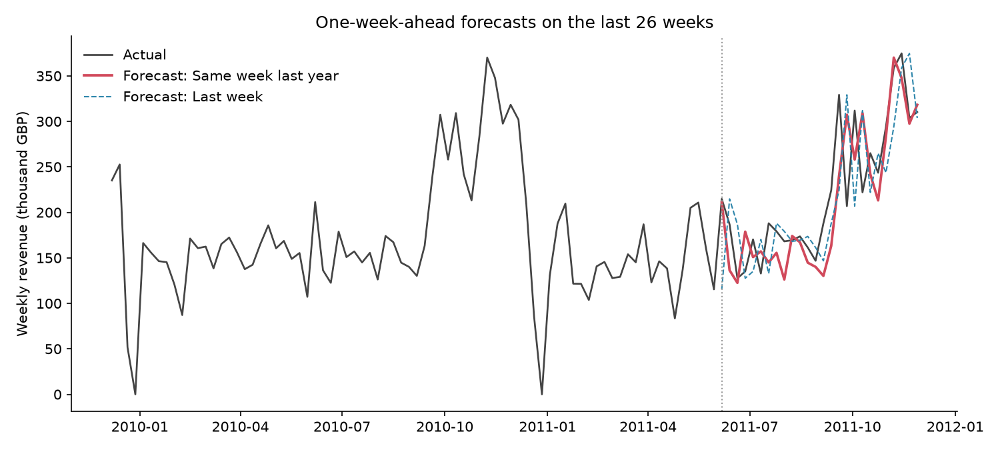

# Weekly sales forecast for an online retailer

Which simple method best predicts next week's revenue for a real shop? This project cleans two years of
real transactions from a UK online gift retailer, sums them by week, and tests six forecasting methods on
26 weeks they had not seen.

It follows an earlier project of mine, [klira-demand-forecast](https://github.com/dimausa2006-pixel/klira-demand-forecast),
which used simulated data. This one uses real data.

## Data

[Online Retail II](https://archive.ics.uci.edu/dataset/502/online+retail+ii) from the UCI Machine Learning
Repository (Chen, 2019; licence CC BY 4.0). It holds 1,067,371 invoice lines from 1 December 2009 to
9 December 2011. The file is 45 MB and is not stored in this repository; `data/weekly_sales.csv`, the cleaned
weekly table, is.

## Cleaning

| Rule | Rows removed | Rows left |
|:--|--:|--:|
| Rows in the raw workbook | | 1,067,371 |
| Invoices repeated in the second sheet | 22,523 | 1,044,848 |
| Cancelled invoices (number starts with C) | 19,165 | 1,025,683 |
| Quantity zero or negative | 3,393 | 1,022,290 |
| Price zero or negative | 2,636 | 1,019,654 |
| Lines that are not products (postage, fees, adjustments) | 4,709 | 1,014,945 |

That leaves 104 full weeks, 7 December 2009 to 28 November 2011, and £18.95 million of revenue.
Two weeks have no sales at all because the shop closes after Christmas. I kept them as zeros.

## Method

The target is revenue per week. The last 26 weeks (6 June to 28 November 2011) are the test weeks.
For each test week, every method sees only the weeks before it and makes one forecast. This is called
a rolling-origin test, and it is how a forecast would be used in practice.

| Method | What it does |
|:--|:--|
| Last week | Repeats the week that just ended |
| 4-week average | Averages the last four weeks |
| Exponential smoothing | Averages all past weeks, counting recent ones more; the weight is chosen on past data |
| Same week last year | Repeats the same week one year earlier |
| Last year x recent growth | Same week last year, scaled by how the last 8 weeks compare with a year ago |
| Regression on past weeks | Linear regression on the last 4 weeks and the same week last year, refitted every week |

Errors are measured in two ways. MAE is the average miss in pounds. WAPE is the total miss as a share of
total sales. Bias shows whether a method forecasts too high (+) or too low (-) on average.

## Results

Average revenue in a test week was £222,544.

| Method | MAE (£) | WAPE % | Bias (£) |
|:--|--:|--:|--:|
| Same week last year | 32,896 | 14.8 | -11,398 |
| Last year x recent growth | 33,461 | 15.0 | +3,173 |
| 4-week average | 34,205 | 15.4 | -16,284 |
| Exponential smoothing | 35,549 | 16.0 | -20,558 |
| Regression on past weeks | 36,211 | 16.3 | -20,761 |
| Last week | 44,120 | 19.8 | -7,498 |



What I take from this:

- Repeating last week is clearly the worst. Sales jump up and down from week to week, so the latest week is
  a noisy guide. Every other method cut the error by about a fifth to a quarter.
- The two methods that use last year did best. The test weeks include the run-up to Christmas, when sales
  roughly double, and only a method that remembers last autumn sees that coming.
- The top three are close: 14.8%, 15.0% and 15.4%. On 26 test weeks I would not claim one is truly better
  than the others.
- The methods that only look at recent weeks forecast too low by £16,000 to £21,000 a week, because sales
  were rising through the test period. Scaling last year by recent growth removed most of that bias.
- The regression did not beat the simple methods. It has only about 50 rows to learn from once a
  one-year lag is used.

## Limits

- Two years of data means each test week has only one earlier year to compare with. A third year could
  change the ranking.
- One shop, one country mix, 2009 to 2011. The result may not carry over to other retailers.
- The forecast is one week ahead. Buying stock usually needs several weeks of notice, which is harder.
- Revenue is forecast for the whole shop, not per product.
- No holidays, promotions or prices are used as inputs.

## Run it

```bash
pip install -r requirements.txt
```

Download `online_retail_II.xlsx` from the UCI page above into `data/raw/`, then:

```bash
python src/prepare.py data/raw/online_retail_II.xlsx
```

```bash
python src/forecast.py
```

```bash
python -m unittest discover tests
```

`prepare.py` takes a few minutes because the workbook has over a million rows. You can skip it:
`data/weekly_sales.csv` is already here.

## Files

- `src/prepare.py`: cleaning rules and the weekly table.
- `src/forecast.py`: the six methods, the rolling test and the chart.
- `tests/test_forecast.py`: 10 tests, including one that checks no method can see the future.
- `reports/`: results table, cleaning log, week-by-week forecasts, chart.

## Source

Chen, D. (2019). Online Retail II [Dataset]. UCI Machine Learning Repository. https://doi.org/10.24432/C5CG6D
